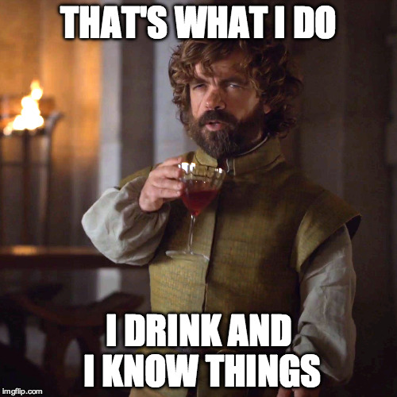

---

title: "The knowledge is not the work"
layout: post
category: blog
tags:
- leadership
- software development
- technology

---

In 2024 I made a career decision I had previously avoided: I was going to move into people management. I had toyed with this idea for most of my career, but felt I needed a combination of the right environment and personal growth. I don't really like doing something and not being good at it, which is a slightly inconvenient personality trait when you're trying something new.

At Tailscale, I saw what I thought was the right fit. A high performing team, a fast growing company and a product that people loved. All I had to do was figure out how to scale the solutions engineering team in a way that helped customers be successful. Easy, right?

As I've grown into management, and from there into a manager of managers role, I've had to reconsider some of the things I valued about myself as an individual contributor. It turns out that being pleased with your own contribution isn't a particularly useful way to assess it.

The one I keep coming back to is _knowing things_.



If you've spent any amount of time in a technical role, you'll probably recognise how this happens. You spend years learning how things work, usually by breaking them in increasingly interesting ways, and eventually become the person people come to when they need an answer.

I like being that person. Someone asks a question in Slack, you know the answer, and you get to jump into the thread with "Hey, it's actually this!"

It feels good. People trust you, your opinions carry weight, and a few emoji reactions provide the dopamine hit that confirms you've been helpful. You can go back to whatever you were doing, safe in the knowledge that you've contributed.

But did they get anywhere? Could they make the decision, fix the deployment or go back to the customer with something useful? Or did I just explain the problem very well and leave them to it?

That's the bit I'm paying more attention to now. I've given myself plenty of credit for knowing things over the years. I should probably have spent more time checking what happened after I shared them.

## Knowing the answer is only the start

Take a hypothetical infrastructure question:

> Can the customer use our Kubernetes deployment example? They need it running in their AWS account.

You know exactly how that example works:

> No, it pulls images from a public registry and their cluster doesn't have internet access.

Correct. You've spotted the constraint and saved someone a failed deployment.

But sometimes you've just explained why they're stuck.

Perhaps you also know that they can mirror the images into ECR, configure private endpoints and change the image references. You've done something similar before. Your colleague hasn't, and "use ECR" leaves them with quite a lot to figure out before their customer call.

Finding the relevant configuration, checking whether anything else needs outbound access and explaining who will keep those images up to date takes more effort. It also gives your colleague something they can actually recommend, including the parts the customer will have to own.

In sales engineering, this is a meaningful part of the job. A colleague needs to understand what we can recommend, where it falls short and whether it'll solve the customer's problem. A detailed explanation of why the first idea won't work only gets them so far.

I've written before about [the amount of knowledge we expect people to have just to get something into production](/blog/2023/09/28/300_percent_problem). If my help requires someone to first acquire several years of my experience, I haven't made their life much easier.

I don't think you have to personally take over every problem you know something about. That would be a fairly quick way to make yourself miserable. But there's a reasonable distance between owning the entire problem and leaving someone with "no, that won't work". We should be willing to cover some of it.

## Okay, but did it help?

Putting a group of knowledgeable people together doesn't guarantee they'll be useful to each other. I might know the product constraint. My colleague knows why the customer can't use the usual workaround. Until we put those facts together, we can both give perfectly reasonable answers that solve absolutely nothing.

"I already answered this" might be true. It's also worth considering why someone still needs help.

This is where my thinking about performance has changed. A week spent answering questions in Slack might be a very productive week. But I need to understand whether people could do something afterwards that they couldn't do before. And if the same questions keep coming up, why are we still relying on one person to answer them?

There might be a good reason. There might also be an opportunity to spend an afternoon making it possible for the rest of the team to handle them without you. You'd get fewer opportunities to demonstrate your expertise, but everyone else would get on with their work. I would consider that a good result.

The annoying part, now that I'm a manager, is that figuring this out requires more effort than noticing who's active in Slack. I can see who posts the answer. I might completely miss the colleague who reads it, realises it won't make sense to the customer, and spends an hour helping them work through it.

If I'm giving all the credit to the person who posted the answer, I'm part of the problem. I can talk about outcomes as much as I like, but people will notice what actually gets recognised.

Of course, a signed contract doesn't prove someone did a good job either. I've worked in sales long enough to know you can do everything right and still lose. You can also win despite yourself. [Outcome bias](https://pubmed.ncbi.nlm.nih.gov/3367280/) is a real problem: knowing how something ended changes how we judge the decisions that led to it.

I need to understand what someone could reasonably influence and whether their judgement made sense at the time. Otherwise, "I care about outcomes" is a convenient excuse for not understanding the work. That includes the things we decided *not* to do.

If your knowledge helped us establish that we weren't a good fit before six people spent a month on a pointless proof of concept, thank you. Please keep doing that.

## More answers, same problem

AI makes this harder to ignore. Your colleague can turn up with three suggested solutions and a convincing explanation of each before you've finished your lunch. Perhaps the entire explanation is bollocks, but it's well formatted bollocks. Someone still has to check whether any of it will work in the customer's environment.

When I [built Landlord with AI](/blog/2026/02/06/landlord), I was working on a problem I'd encountered years before. I still had to catch the model making tradeoffs I didn't want and correct it while we were working through the spec. Having the experience was useful because I could apply it to what was being built.

I'm happy to use these tools. What I don't want is for us to produce ten times as many answers and congratulate ourselves without checking whether anyone got anywhere.

I think the takeaway is simple: spend less time being the person with the answer in Slack, and more time getting that knowledge into the hands of people who can use it.